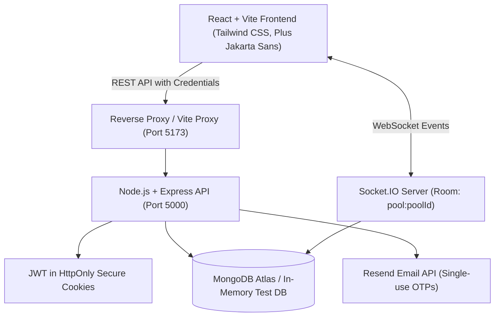

# NightOwl — Hostel Group Ordering 🦉

> **Tagline:** *Your midnight cravings, together.*

NightOwl is a production-minded web application engineered for college students living in **Uniworld 1** and **Uniworld 2** hostels. Students combine shopping orders from instant-commerce retailers (**Blinkit**, **Zepto**, **Flipkart Minutes**) so that smaller purchases can meet minimum order thresholds, eliminate duplicate delivery fees, and split shared charges transparently.

> [!NOTE]
> **Coordination Model:** NightOwl coordinates group orders between verified hostel peers; it does not claim to place retailer orders automatically through retailer APIs. The pool owner manually places the combined cart in the retailer's app and records the actual receipt in NightOwl.

---

## 📌 Submission Details

| Field | Detail |
|---|---|
| **Project Name** | NightOwl — Hostel Group Ordering |
| **Student Name** | *[Insert Student Name Here]* |
| **Problem Statement** | Eliminating individual delivery fees and minimum order friction for late-night hostel cravings through real-time collaborative pooling and deterministic cost splitting |
| **GitHub Repository** | *[Insert GitHub URL Placeholder]* |
| **Live Frontend URL** | *[Insert Vercel Deployment URL Placeholder]* |
| **Live Backend API URL** | *[Insert Render Deployment URL Placeholder]* |
| **Demo Video Walkthrough** | *[Insert Demo Video URL Placeholder (Loom / YouTube)]* |
| **Primary Tech Stack** | React (Vite, TS) + Tailwind CSS + Node.js/Express + MongoDB + Socket.IO + Zod |

---

## 🏗️ Architecture & System Design

NightOwl employs a decoupled client-server architecture with real-time bidirectional WebSocket rooms and secure session management.



### Key Architectural Decisions
1. **Security & Session Authentication**: Passwordless authentication via single-use, time-limited (10 min) Email OTPs sent to official `@sst.scaler.com` college addresses. Sessions are held in `HttpOnly`, `SameSite` JWT cookies to eliminate XSS token theft.
2. **Deterministic Proportional Splitting**: Shared delivery and surge fees are allocated proportionally to each participant's item subtotal down to the paisa (`₹0.01`), with deterministic remainder allocation to preserve exact mathematical equality with the retailer receipt.
3. **Real-time Synchronized Cart**: Socket.IO rooms partitioned by `pool:${poolId}` broadcast item additions, edits, deletions, and status transitions without requiring client polling.
4. **Data Isolation & Expiry Lifecycle**: State machine transitions (`OPEN` → `LOCKED` → `ORDERED` → `DELIVERED` or `CANCELLED`/`EXPIRED`) are enforced server-side. Background schedulers and on-access guards ensure expired pools automatically close.

---

## 🚀 Core Workflows

### 1. Identity & Campus Verification
- Students register with their full name, 10-digit Indian mobile number (`^[6-9]\d{9}$`), hostel (`Uniworld 1` or `Uniworld 2`), optional room number, and college email matching `^[a-zA-Z0-9._%+-]+@sst\.scaler\.com$`.
- Single-use 6-digit OTP verification with 60s resend cooldown, 5-attempt brute-force protection, and 10-minute expiry.
- In development/test mode, OTPs are printed to server logs for seamless testing.

### 2. Discover & Create Order Pools
- Filter pools by hostel (`Uniworld 1` vs `Uniworld 2`), retailer brand (`Blinkit`, `Zepto`, `Flipkart Minutes`, `Other`), and pool status (`OPEN`, `LOCKED`, `ORDERED`, `DELIVERED`).
- Hosts specify delivery zone / pickup spots (e.g. "Block A Ground Lobby", "Main Gate"), target minimum amount (e.g. ₹500), optional per-person contribution caps, participant limits, and closing deadlines.

### 3. Real-Time Collaborative Cart
- Roommates join open pools and add items with quantity and unit price. Subtotals are strictly calculated server-side (`quantity * unitPrice`).
- Users can edit or delete their own items while the pool remains `OPEN`.
- Instant Socket.IO broadcasts update connected clients with subtotal progress bars, remaining amounts, and participant counts.

### 4. Lock, Order, and Complete
- Only the pool creator can lock the pool once the target is reached or deadline nears.
- Host places the order in the retailer app, returns to NightOwl, and enters the final receipt details (actual payable total, delivery fee, handling charges, and host UPI ID).
- Status advances to `ORDERED`, triggering automatic proportional cost splitting.
- Upon arrival at the hostel pickup spot, the host marks the pool as `DELIVERED`.

### 5. Deterministic Cost Splitting & UPI Tracking
- Each participant views their item subtotal and their allocated share of eligible fees.
- Students copy the host's UPI ID, send their payment in their UPI app (GPay/PhonePe/Paytm), and submit the 12-digit transaction UTR reference.
- The host confirms receipt in the review panel, marking the payment `CONFIRMED`.
- No UPI PINs or banking credentials are ever collected or stored.

---

## 📐 Data Models

### User Model (`User`)
- `fullName`: String (2-60 chars)
- `email`: String (Unique, matches `^[a-zA-Z0-9._%+-]+@sst\.scaler\.com$`)
- `phoneNumber`: String (10 digits)
- `hostel`: Enum (`Uniworld 1`, `Uniworld 2`)
- `roomNumber`: String (optional)
- `isEmailVerified`: Boolean (Default: false)
- `role`: Enum (`student`, `moderator`)

### Pool Model (`Pool`)
- `title`: String
- `retailer`: Enum (`Blinkit`, `Zepto`, `Flipkart Minutes`, `Other`)
- `hostel`: Enum (`Uniworld 1`, `Uniworld 2`)
- `deliveryZone`: String (e.g., "Block A Ground Lobby")
- `targetAmount`: Number (e.g., ₹500)
- `contributionCap`: Number (optional)
- `participantLimit`: Number (2 to 30)
- `closingTime`: Date
- `creator`: Ref `User`
- `status`: Enum (`OPEN`, `LOCKED`, `ORDERED`, `DELIVERED`, `CANCELLED`, `EXPIRED`)
- `currentSubtotal`: Number (server-aggregated sum)
- `participants`: Array of Ref `User`
- `finalPayableAmount`, `deliveryFee`, `otherCharges`: Number
- `upiId`: String

### PoolItem Model (`PoolItem`)
- `poolId`: Ref `Pool` (indexed)
- `userId`: Ref `User` (indexed)
- `name`: String
- `quantity`: Number (integer >= 1)
- `unitPrice`: Number (INR >= 1)
- `itemSubtotal`: Number (`quantity * unitPrice`)
- `note`: String (optional)

### PaymentRecord Model (`PaymentRecord`)
- `poolId`: Ref `Pool`
- `userId`: Ref `User`
- `itemSubtotal`: Number
- `allocatedFee`: Number (proportional share)
- `totalDue`: Number (`itemSubtotal + allocatedFee`)
- `paymentStatus`: Enum (`PENDING`, `SUBMITTED`, `CONFIRMED`, `REJECTED`)
- `paymentReference`: String (UTR / UPI transaction ID)
- Compound index `{ poolId: 1, userId: 1 }` (Unique)

### AuditEvent Model (`AuditEvent`)
- `poolId`: Ref `Pool`
- `userId`: Ref `User`
- `action`: String (e.g., `POOL_CREATED`, `ITEM_ADDED`, `POOL_LOCKED`, `ORDER_PLACED`, `PAYMENT_SUBMITTED`, `PAYMENT_CONFIRMED`)
- `details`: Object
- `createdAt`: Date

---

## 🔌 REST API Endpoints

### Authentication (`/api/auth`)
| Method | Endpoint | Description | Auth Required |
|---|---|---|---|
| `POST` | `/api/auth/register` | Register new student & send OTP | No (Rate-limited) |
| `POST` | `/api/auth/login-request` | Request login OTP | No (Rate-limited) |
| `POST` | `/api/auth/verify-otp` | Verify 6-digit OTP & set HttpOnly cookie | No |
| `POST` | `/api/auth/resend-otp` | Resend verification code (60s cooldown) | No |
| `GET` | `/api/auth/me` | Restore user session from cookie | Yes |
| `PATCH` | `/api/auth/profile` | Update room number or phone | Yes |
| `POST` | `/api/auth/logout` | Clear session cookie | Yes |

### Order Pools (`/api/pools`)
| Method | Endpoint | Description | Auth Required |
|---|---|---|---|
| `GET` | `/api/pools` | Discover pools with hostel, retailer, status filters | No |
| `POST` | `/api/pools` | Create a new pool | Yes (Verified) |
| `GET` | `/api/pools/:id` | Get full pool details, items, splits, audit | No |
| `POST` | `/api/pools/:id/join` | Join open pool | Yes (Verified) |
| `POST` | `/api/pools/:id/leave` | Leave pool and delete own items | Yes |
| `POST` | `/api/pools/:id/lock` | Lock pool (Host only) | Yes (Host) |
| `POST` | `/api/pools/:id/order-placed` | Record final bill & calculate proportional splits | Yes (Host) |
| `POST` | `/api/pools/:id/deliver` | Mark order as delivered | Yes (Host) |
| `POST` | `/api/pools/:id/cancel` | Cancel pool | Yes (Host) |
| `GET` | `/api/pools/history/my` | View hosted and joined pools | Yes |

### Cart Items (`/api/pools/:poolId/items`)
| Method | Endpoint | Description | Auth Required |
|---|---|---|---|
| `POST` | `/api/pools/:poolId/items` | Add item to pool cart | Yes (Verified) |
| `PATCH` | `/api/pools/:poolId/items/:itemId`| Edit item quantity or price | Yes (Item Owner) |
| `DELETE`| `/api/pools/:poolId/items/:itemId`| Remove item from cart | Yes (Owner/Host) |

### Payments (`/api/pools/:poolId/payment`)
| Method | Endpoint | Description | Auth Required |
|---|---|---|---|
| `POST` | `/api/pools/:poolId/payment` | Submit UPI UTR reference | Yes (Participant) |
| `POST` | `/api/pools/:poolId/payment/:paymentId/review` | Confirm or reject payment | Yes (Host only) |

---

## ⚡ Socket.IO Real-Time Events

- **Room Partitioning:** `pool:${poolId}`
- **Authentication Handshake:** Authenticated via cookie or handshake auth token.
- **Events Emitted by Server:**
  - `cart:item_added`: Emitted when any student adds an item.
  - `cart:item_updated`: Emitted when an item quantity or price changes.
  - `cart:item_deleted`: Emitted when an item is removed.
  - `pool:status_changed`: Emitted on `LOCKED`, `ORDERED`, `DELIVERED`, `CANCELLED`, or `EXPIRED`.
  - `payment:record_updated`: Emitted when a student submits UTR or host reviews payment.

---

## 💻 Local Development Setup

### Prerequisites
- Node.js v20+ (tested on Node v25.1.0)
- npm v10+ (tested on npm 11.6.2)
- MongoDB instance (local `mongodb://localhost:27017` or MongoDB Atlas URI)

### 1. Clone & Install Dependencies
```bash
git clone <repository-url>
cd nightowl
npm install
```

### 2. Configure Environment Variables
Copy `.env.example` to `server/.env`:
```bash
cp .env.example server/.env
```
*(Default settings connect to local MongoDB. In development, Resend API key is optional; OTPs will automatically print to the console).*

### 3. Seed Demo Data (Optional but Recommended)
Populate the database with clearly labelled demo students and pools across Uniworld 1 and Uniworld 2:
```bash
npm run seed
```

### 4. Run the Full Application Locally
```bash
npm run dev
```
- Frontend: `http://localhost:5173`
- Backend API: `http://localhost:5000`
- Health Check: `http://localhost:5000/api/health`

### Demo Credentials
| Name | Hostel | College Email | Role |
|---|---|---|---|
| Arjun Mehta | Uniworld 1 | `arjun.demo@sst.scaler.com` | Student / Host |
| Priya Sharma | Uniworld 1 | `priya.demo@sst.scaler.com` | Student |
| Rohit Verma | Uniworld 2 | `rohit.demo@sst.scaler.com` | Student / Host |
| Ananya Rao | Uniworld 2 | `ananya.demo@sst.scaler.com` | Student |

*(Use the "Passwordless Log in" tab on `/auth` with any demo email; check the server console for your 6-digit OTP).*

---

## 🧪 Testing Suite

NightOwl includes comprehensive automated tests built with **Vitest** and **Supertest** running against an isolated in-memory MongoDB instance (`mongodb-memory-server`):
- Non-college email validation & rejection
- Indian phone number validation
- Time-limited OTP verification, single-use enforcement, and 5-attempt brute-force protection
- Cross-hostel pool discovery and filtering (Uniworld 1 vs Uniworld 2)
- Duplicate join prevention
- Server-side item price, quantity, and subtotal calculation
- Contribution cap enforcement
- Prevention of item modifications after locking
- Proportional cost split algorithm with exact remainder allocation
- Owner-only payment verification authorization (403 Forbidden for non-owners)

To execute all tests:
```bash
npm test
```

To run tests in watch mode:
```bash
npm run test:watch --workspace=server
```

---

## 🚢 Production Deployment Guide

### Frontend Deployment (Vercel)
1. Link the repository to Vercel with Root Directory set to `client`.
2. Framework Preset: `Vite`.
3. Build Command: `npm run build`.
4. Output Directory: `dist`.
5. Environment Variable:
   - `VITE_API_URL`: URL of your deployed backend (e.g. `https://nightowl-api.onrender.com`).
6. `client/vercel.json` already contains the SPA routing rewrites.

### Backend Deployment (Render)
1. Create a new Web Service on Render from the repository.
2. Root Directory: `server`.
3. Build Command: `npm install && npm run build`.
4. Start Command: `npm run start`.
5. Environment Variables:
   - `NODE_ENV`: `production`
   - `PORT`: `10000`
   - `MONGODB_URI`: Your MongoDB Atlas connection URI (`mongodb+srv://...`)
   - `JWT_SECRET`: 32+ character random secret string
   - `CLIENT_URL`: URL of your deployed frontend (e.g. `https://nightowl.vercel.app`)
   - `RESEND_API_KEY`: API key from [resend.com](https://resend.com)
   - `EMAIL_FROM`: `NightOwl <onboarding@resend.dev>`
   - `COLLEGE_EMAIL_DOMAIN`: `sst.scaler.com`

---

## 🎬 3–5 Minute Demo Script

1. **The Problem (0:00 - 0:45)**:
   - Show late-night craving scenario at Uniworld 1 hostel.
   - Ordering one item on Blinkit adds ₹40 delivery fee and minimum order friction.
2. **Registration & College Email Verification (0:45 - 1:30)**:
   - Open NightOwl on mobile/browser.
   - Register with `arjun.demo@sst.scaler.com` and select `Uniworld 1`.
   - Receive and input the 6-digit OTP. Note that only `@sst.scaler.com` accounts can access order pools.
3. **Discovering & Joining a Pool (1:30 - 2:30)**:
   - Open the Dashboard. Filter by `Uniworld 1` and `Blinkit`.
   - Open a pool with ₹330 / ₹500 met.
   - Add items (Doritos & Red Bull). Watch the progress bar instantly update via Socket.IO across devices to unlock the free delivery threshold.
4. **Locking & Order Confirmation (2:30 - 3:30)**:
   - Host locks the pool to prevent edits.
   - Host places order on Blinkit and confirms final bill amount (₹530), delivery fee (₹0), and handling fee (₹15), plus their UPI ID.
   - Point out the deterministic proportional split: fees are distributed based on item subtotals down to the paisa.
5. **Reimbursement & Delivery Completion (3:30 - 4:30)**:
   - Participant copies host's UPI ID, pays, and submits transaction UTR.
   - Host verifies UTR and clicks "Confirm Payment".
   - Host marks "Delivered" upon arrival at the lobby with celebration confetti.

---

## ⚠️ Known Limitations & Assumptions

1. **Manual Retailer Ordering**: Retailers (Blinkit, Zepto, Flipkart Minutes) do not provide public open checkout APIs. NightOwl coordinates the group order; the pool host places the combined order in the retailer app.
2. **Reimbursement Verification**: Payment confirmation is verified by the host checking their personal UPI application rather than an automated banking web-hook. This avoids requiring banking credentials.
3. **Campus Scope**: Accounts are restricted to `@sst.scaler.com` students residing in Uniworld 1 or Uniworld 2.

---

## 🤖 AI Usage Disclosure

In compliance with project guidelines, this application was built with the assistance of **Google Antigravity** (Advanced Agentic Coding) for architectural scaffolding, automated test suite authoring, and UI styling. All business logic, deterministic splitting math, security constraints, and database queries were rigorously engineered, verified, and tested.
