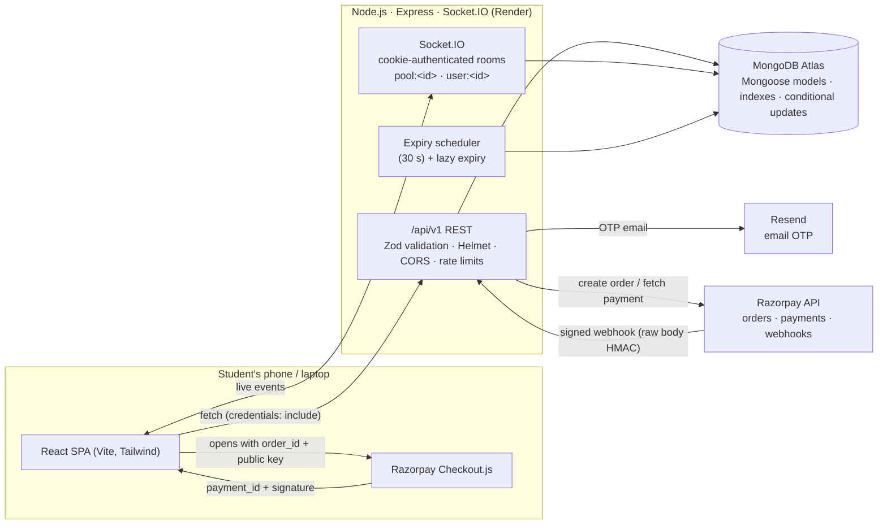

# 🦉 NightOwl — Your midnight cravings, together.

A full-stack group-ordering platform for students of **Uniworld 1** and **Uniworld 2** hostels. Small late-night purchases from Blinkit, Zepto, Flipkart Minutes (or any retailer) are combined into one shared cart, tracked live, and the fees are split fairly to the paisa.

**Live:** app → https://nightowl-tau.vercel.app · API health → https://nightowl-api-vljl.onrender.com/api/v1/health · code → https://github.com/jasraj15/NIGHTOWL
*(Free tiers: the API sleeps after 15 min idle, so the first request can take ~30 s. Email delivery isn't configured, so the login screen shows the verification code itself — see §15.)*

> **What NightOwl is not:** it is an independent coordination tool. It never accesses retailer carts, prices, stock or APIs, and it does not place orders for you. The pool host places the order in the retailer's app and records the real bill in NightOwl.

---

## Table of contents

1. [Problem statement](#1-problem-statement)
2. [Target users](#2-target-users)
3. [Product solution & key features](#3-product-solution--key-features)
4. [Technology stack](#4-technology-stack)
5. [Architecture](#5-architecture)
6. [Database design](#6-database-design)
7. [REST API](#7-rest-api)
8. [Socket.IO events](#8-socketio-events)
9. [Authentication & security decisions](#9-authentication--security-decisions)
10. [Razorpay payment flow](#10-razorpay-payment-flow)
11. [Environment variables](#11-environment-variables)
12. [Local setup](#12-local-setup)
13. [Testing](#13-testing)
14. [Deployment](#14-deployment)
15. [Known limitations & deviations](#15-known-limitations--deviations)
16. [AI usage disclosure](#16-ai-usage-disclosure)
17. [Demo instructions](#17-demo-instructions)

Supporting documents: [`docs/SUBMISSION.md`](docs/SUBMISSION.md) · [`docs/DEMO_VIDEO_OUTLINE.md`](docs/DEMO_VIDEO_OUTLINE.md) · [`docs/DEPLOYMENT.md`](docs/DEPLOYMENT.md) · [`docs/PAYMENTS.md`](docs/PAYMENTS.md)

---

## 1. Problem statement

Students in hostels often want ₹80 of snacks at 1 am, but quick-commerce apps require a ₹200–₹300 minimum order and charge delivery/handling fees per order. Individually, the order is impossible or expensive; collectively, three students on the same floor easily cross the minimum and share one fee. Today that coordination happens in chaotic WhatsApp threads with no shared cart, no deadline, no record of who owes what and no proof of payment.

## 2. Target users

Verified college students with an `@sst.scaler.com` email who live in **Uniworld 1** or **Uniworld 2**. The two hostels have different delivery addresses, so every pool belongs to exactly one hostel and participants must confirm the pickup location before joining.

## 3. Product solution & key features

| Workflow | What happens |
|---|---|
| **Verify & onboard** | Register with name, Indian mobile, college email → 6-digit email OTP (10-min expiry, 5 attempts, 60-s resend cooldown, rate-limited) → dedicated **hostel-selection screen** → dashboard. Session restored from an HttpOnly cookie on refresh. |
| **Discover** | Dashboard with greeting, current hostel, summary cards from real data, recommended pools *with reasons*, search, hostel/retailer/closing-soon/amount-remaining/participant filters, live refresh over Socket.IO. |
| **Create a pool** | Dedicated page: retailer, title, hostel, confirmed pickup spot, minimum order value, optional participant limit & per-person cap, countdown presets (5–60 min) or custom (5–180), expected fees. Countdown starts from the **server's** clock. |
| **Live collaborative cart** | Join (with delivery confirmation), add/edit/remove your own items, see everyone's items grouped by participant, combined total, amount remaining, countdown and status — all pushed live via authenticated Socket.IO rooms; state recovers on refresh/reconnect from the database. |
| **Order lifecycle** | `OPEN → LOCKED → ORDERED → DELIVERED` plus `CANCELLED` / `EXPIRED`. Host locks (must explicitly confirm the retailer's real requirement if below target), can reopen (until any payment starts), extend (≤3 times), cancel; records the real bill, retailer minimum, delivery + other fees; marks delivered. Every transition is a conditional DB update and is written to an audit trail. |
| **Fair cost split** | Shared fees are allocated **proportionally to item subtotal**, rounded to the paisa with deterministic remainder distribution so shares sum exactly to the bill. The full table is shown to every member. |
| **Payments** | Genuine **Razorpay Checkout** (server-created order → checkout → server-side HMAC signature verification → provider confirmation → idempotent persistence; webhooks verified with the webhook secret and processed exactly once). Clearly-labelled **manual UPI fallback** (participant submits UTR, host confirms) when Razorpay keys are absent. Statuses: `PENDING, PROCESSING, PAID, FAILED, REFUND_PENDING, REFUNDED`. |
| **Orders** | Tabs: Active · Created by me · Joined by me · Completed · Cancelled · All, each with my items, my fee share, my payment status. "Order again" duplicates a finished order into a **new draft** without touching the original. |
| **Notifications** | Persisted in-app notification centre with unread badge, live push, mark-read/all, delete, deep links; six per-type preferences honoured server-side. |
| **Settings** | Profile (name, phone, default hostel, room), notification preferences, privacy (show phone to pool members), security info + logout, payment history with transaction references, dark/light/system theme persisted to the profile, account deactivation that keeps financial history intact. |
| **Moderation & analytics** | Report a pool/participant; moderator-only endpoints to review reports and view platform analytics; personal stats (pools created/joined/completed, participation rate, average time to lock) computed from persisted data — no fabricated savings. |

## 4. Technology stack

**Frontend (`/client`)** — React 18, Vite 6, TypeScript (strict), Tailwind CSS 3 with semantic CSS-variable tokens (dark/light), React Router 6, Socket.IO client, Lucide icons, `canvas-confetti`. A small hand-rolled `useAsync` hook and validation layer stand in for TanStack Query / React-Hook-Form / Zod — see [Deviations](#15-known-limitations--deviations).

**Backend (`/server`)** — Node.js 20+, Express 4, TypeScript (ESM), MongoDB + Mongoose 8, Socket.IO 4, Zod validation, Helmet, CORS allow-list, express-rate-limit, cookie-parser, jsonwebtoken, Resend (email OTP), Razorpay REST API via Node `fetch` + `crypto` HMAC verification, Vitest + Supertest + mongodb-memory-server for tests.

**Infra** — npm workspaces monorepo; Vercel (frontend), Render (backend, `render.yaml`), MongoDB Atlas.

```
nightowl/
├── client/                 # React + Vite SPA
│   ├── src/components/     # ui (Button, Field, Modal, Bits), brand, pools, cart, payment, audit, notifications
│   ├── src/pages/          # Landing, Auth, SelectHostel, Dashboard, CreatePool, PoolDetails, Orders, Notifications, Settings, Legal, NotFound
│   ├── src/layouts/        # AppLayout (navbar, notification bell, mobile tab bar)
│   ├── src/context/        # Auth, Theme, Toast, Notification providers
│   ├── src/hooks/          # useAsync, useCountdown (server-clock aware), useDebounce
│   ├── src/services/       # api (fetch wrapper), socket, razorpay (checkout loader)
│   ├── src/types/ · src/utils/
│   ├── index.html · tailwind.config.js · vite.config.ts · vercel.json · .env.example
├── server/                 # Express + Socket.IO API
│   ├── src/config/         # env (Zod-validated), db
│   ├── src/models/         # User, Pool, PoolItem, PaymentRecord, PaymentEvent, Notification, AuditEvent, OtpToken, Report
│   ├── src/routes/ · controllers/ · validators/ · middlewares/ (auth, rateLimiter, sanitize, errorHandler)
│   ├── src/services/       # emailService, costSplitService, paymentService, razorpayClient, socketService, notificationService, poolExpiryService
│   ├── src/tests/          # Vitest + Supertest suites (in-memory MongoDB)
│   ├── src/app.ts          # Express app (exported for tests) · src/index.ts (HTTP + Socket.IO server)
│   ├── src/scripts/seed.ts · .env.example
├── docs/                   # submission template, demo outline, deployment, payments
├── tools/dev-runner.command # optional local job runner used during development
├── package.json            # workspaces: server, client · render.yaml · .gitignore
```

## 5. Architecture



Key decisions:

* **Database is the source of truth.** Socket events are hints; every client re-fetches `/pools/:id` on membership/status changes and on reconnect, so a refreshed or reconnected tab always converges.
* **Server-side money math.** Subtotals, pool totals, proportional fee splits and the paise amount sent to Razorpay are computed on the server; client-supplied totals/amounts are never trusted.
* **Conditional state transitions.** Join/leave/lock/reopen/order/deliver/cancel use `findOneAndUpdate` with the expected current status, so concurrent requests cannot double-apply (tested).
* **Server-timed countdowns.** `closingTime = serverNow + durationMinutes`; the client computes clock skew from `serverTime` in each payload. Expiry is enforced by a scheduler and lazily on access, even if every browser is closed.

## 6. Database design

| Model | Purpose | Notable fields & indexes |
|---|---|---|
| **User** | Verified student | `email` (unique, regex `@sst.scaler.com`), `phoneNumber`, `hostel`, `hostelSelected`, `isEmailVerified`, `role` (`student`/`moderator`), `status`, `preferences{theme, notifications{…6 flags}, showPhoneToPoolMembers}`, `razorpayLinkedAccountId`. Public projection never includes phone. |
| **OtpToken** | Email OTP | `email+purpose`, `otpHash` (SHA-256), `attempts`, `expiresAt` (TTL), `resendAfter`. |
| **Pool** | Group order | `creator`, `retailer(+customName)`, `hostel`, `deliveryZone`, `targetAmount`, `contributionCap`, `participantLimit`, `closingTime`, `status`, `participants[]`, cached `currentSubtotal`, `finalPayableAmount`, `actualRetailerMinimum`, `deliveryFee`, `otherCharges`, `upiId`, `extensionCount`, `proceedBelowTargetConfirmed`, lifecycle timestamps. Indexes: `{hostel,status,createdAt}`, `{retailer,status}`, `{participants}`, `{status,closingTime}`, `{creator,status,createdAt}`. |
| **PoolItem** | Cart line | `poolId`, `userId`, `name`, `quantity`, `unitPrice`, server-computed `itemSubtotal`, `note`. Index `{poolId, userId}`. |
| **PaymentRecord** | One participant's contribution | `itemSubtotal`, `allocatedFee`, `totalDue`, integer `amountPaise`, `paymentStatus`, `paymentMethod`, `razorpayOrderId/PaymentId/RefundId`, `signatureVerifiedAt`, `providerConfirmedAt`, manual `paymentReference`, review fields. Unique `{poolId,userId}`; indexes on Razorpay ids. |
| **PaymentEvent** | Idempotency ledger | unique `providerEventId`, `source` (`WEBHOOK`/`CHECKOUT_VERIFY`), `eventType`, `processingStatus` (`PROCESSED/IGNORED/FAILED/DUPLICATE`). A redelivered webhook hits the unique index → no side effects. |
| **Notification** | In-app inbox | `recipient`, `type`, `title`, `message`, `poolId`, `read`. Index `{recipient, read, createdAt}`. |
| **AuditEvent** | Audit trail | `poolId`, `userId`, `action`, `details`, `ipAddress`. |
| **Report** | Moderation | `reporter`, `poolId`, `reportedUser`, `reason`, `status`, moderator fields. |

## 7. REST API

Base path `/api/v1` (an unversioned `/api` alias is kept for compatibility). All responses are JSON `{ success, ... }`; errors are `{ success:false, error, details?[] , code? }`. Auth = HttpOnly cookie `nightowl_token` (7-day JWT). "Verified" = cookie + `isEmailVerified`.

| Method & path | Auth | Description |
|---|---|---|
| `GET /health` | – | DB + payment-provider status |
| `POST /auth/register` | – | Create unverified account, send OTP (rate-limited) |
| `POST /auth/login-request` | – | Send login OTP |
| `POST /auth/verify-otp` | – | Verify code → sets cookie, returns `user` + `nextStep` (`select-hostel`/`dashboard`) |
| `POST /auth/resend-otp` | – | Resend (60-s cooldown) |
| `GET /auth/me` · `GET /users/me` | cookie | Restore session (+ unread notification count) |
| `POST /auth/logout` | cookie | Clear cookie |
| `PATCH /users/me` | cookie | Profile (name, phone, hostel, room) |
| `POST /users/me/hostel` | verified | Onboarding hostel selection |
| `PATCH /users/me/preferences` | cookie | Theme, notification prefs, phone visibility |
| `GET /users/me/stats` | cookie | Personal analytics from persisted data |
| `DELETE /users/me` | cookie | Deactivate (requires `confirmEmail`) |
| `GET /pools` | verified | Discovery: `hostel, retailer, status, search, closingSoon, maxRemaining, minParticipants, maxParticipants, sort, page, limit` |
| `GET /pools/recommended` | verified | Recommended pools with explicit `reasons[]` |
| `GET /pools/orders/mine?tab=` | verified | Orders by tab with counts, my items & contribution |
| `POST /pools` | verified + hostel selected | Create (server computes `closingTime`) |
| `GET /pools/:id` | verified | Pool, items, payment records (sanitised per viewer), breakdown, audit, viewer role, countdown |
| `GET /pools/:id/duplicate-draft` | verified, member | New draft from a previous order |
| `POST /pools/:id/join` · `/leave` | verified | Join requires `deliveryConfirmed:true`; atomic, capacity-safe |
| `POST /pools/:id/items` · `PATCH/DELETE /pools/:id/items/:itemId` | verified, member | Items; only owner edits, owner/host deletes; blocked once locked |
| `POST /pools/:id/lock` | host | `OPEN→LOCKED`; `proceedBelowTargetConfirmed` required if below target |
| `POST /pools/:id/reopen` | host | `LOCKED→OPEN` (only before any payment) |
| `POST /pools/:id/extend` | host | Extend `OPEN`/`EXPIRED` (≤3 times) |
| `POST /pools/:id/order-placed` (alias `/complete`) | host | `LOCKED→ORDERED`, records bill & fees, creates contributions |
| `POST /pools/:id/deliver` | host | `ORDERED→DELIVERED` |
| `POST /pools/:id/cancel` | host | → `CANCELLED` (not after verified payments) |
| `POST /pools/:id/report` | verified | File a report (rate-limited) |
| `GET /payments/config` | – | Public payment config (provider, public key id, test mode) |
| `GET /payments/history` | cookie | My contributions across pools |
| `GET /pools/:id/payments/me` | member | My contribution + breakdown |
| `POST /pools/:id/payments/razorpay/order` | member | Create Razorpay order for the server-computed amount |
| `POST /pools/:id/payments/razorpay/verify` | member | Verify checkout signature, confirm with provider, persist |
| `POST /payments/razorpay/webhook` | HMAC | Raw-body webhook; idempotent |
| `POST /pools/:id/payments/manual` | member | Submit UPI reference (fallback) |
| `POST /pools/:id/payments/:paymentId/review` | host | Confirm/reject a manual reference |
| `GET /notifications` · `PATCH /:id/read` · `POST /read-all` · `DELETE /:id` | cookie | Own notifications only |
| `GET /admin/reports` · `PATCH /admin/reports/:id` · `GET /admin/analytics` | moderator | Moderation & platform analytics |

## 8. Socket.IO events

Connection is authenticated in the handshake from the `nightowl_token` cookie; the socket joins its private `user:<id>` room. Clients call `pool:join_room(poolId, ack)` to watch a pool (any verified student may watch a discoverable pool's cart; payment details are only ever emitted to private user rooms).

| Event | Room | Payload |
|---|---|---|
| `pool:participant_joined` / `pool:participant_left` | pool | participant, participantCount |
| `cart:item_added` / `cart:item_updated` / `cart:item_deleted` | pool | item / itemId, currentSubtotal, remainingAmount, progressPercent |
| `pool:total_changed` | pool | currentSubtotal, remainingAmount, progressPercent |
| `pool:updated` | pool + discovery | type hint to refetch |
| `pool:locked` · `pool:status_changed` · `pool:expired` · `order:status_changed` | pool | status (+ closingTime / fees) |
| `payment:status_changed` | payer & host user rooms | sanitised record + status |
| `payment:record_updated` | pool | userId + status only (non-sensitive) |
| `notification:new` | user | the persisted notification |

## 9. Authentication & security decisions

* **Passwordless email OTP** instead of passwords: nothing to leak or reset; ownership of the college mailbox is what matters. OTPs are hashed at rest, expire in 10 minutes, lock after 5 wrong attempts, are single-use and have a 60-second resend cooldown; `/auth/*` is rate-limited separately. Look-alike domains (`sst.scaler.com.evil.com`) are rejected.
* **Session** = 7-day JWT in an `HttpOnly` cookie — `Secure` + `SameSite=None` in production (cross-site Vercel ↔ Render), `SameSite=Lax` in development. CSRF exposure is limited because every mutating route requires JSON bodies with an explicit `Content-Type` and the CORS allow-list is restrictive; no cookie-authenticated form posts exist.
* **Authorization on every route**: host-only transitions, owner-only item edits, member-only payment views; phone numbers are stripped from public projections and shown only when the host opts in; payment references/IDs are visible only to the payer and the host.
* **Hardening**: Helmet headers, CORS allow-list, 200 kB JSON body limit (256 kB raw for the webhook), Mongo operator sanitisation + regex escaping of search input, Zod validation of every body/query, environment validated at boot, generic error responses in production, OTPs/tokens never logged.
* **Payments**: server-created orders, HMAC-SHA256 signature verification with constant-time comparison, provider confirmation before `PAID`, webhook signature over the raw body, unique `providerEventId` for idempotency, amounts compared in paise, secrets never sent to the browser.

## 10. Razorpay payment flow

See [`docs/PAYMENTS.md`](docs/PAYMENTS.md) for the full write-up, test-mode setup and the **recipient-settlement** discussion. In short:

1. Participant clicks **Pay** → `POST /pools/:id/payments/razorpay/order`.
2. Server recomputes the contribution from items (never the client), creates a Razorpay **order** with the key secret, stores `razorpayOrderId`, status `PROCESSING`.
3. Browser opens **Razorpay Checkout** with the returned `order.id` and the public key id only.
4. Checkout returns `razorpay_payment_id` + `razorpay_signature` → `POST …/razorpay/verify`.
5. Server checks the order belongs to this user's contribution, verifies `HMAC_SHA256(order_id|payment_id, key_secret)`, then **fetches the payment from Razorpay** and only marks `PAID` when `status === 'captured'` and the amount matches — recorded exactly once via `PaymentEvent`.
6. **Webhook** `payment.captured` / `payment.failed` / `refund.*` (raw-body HMAC with the webhook secret) converges the same record idempotently; redeliveries are no-ops.
7. The UI shows success **only after** server verification.

**Who receives the money?** A standard Checkout payment settles to the platform's Razorpay merchant account, not to the student host. Paying hosts out requires **Razorpay Route** (linked accounts with KYC). The code supports Route transfers (`RAZORPAY_ROUTE_ENABLED=true` + `user.razorpayLinkedAccountId`) but it is **off by default** and documented as an integration requirement; NightOwl never claims funds reached a host unless the provider workflow confirms it. Without Razorpay keys the app runs the clearly-labelled **manual UPI reference** flow (host-verified). No real payment or payout is ever simulated.

## 11. Environment variables

Backend (`server/.env`, template in `server/.env.example`):

| Variable | Required | Notes |
|---|---|---|
| `PORT` | no (5000) | |
| `NODE_ENV` | no | `development` / `production` / `test` |
| `CLIENT_URL` | prod | Frontend origin for CORS/Socket.IO |
| `EXTRA_ALLOWED_ORIGINS` | no | Comma-separated preview origins |
| `MONGODB_URI` | yes | Atlas or local |
| `JWT_SECRET` | yes | ≥16 chars; long random in prod |
| `COOKIE_DOMAIN` | no | Only if API & app share a parent domain |
| `RESEND_API_KEY` / `EMAIL_FROM` | prod | Empty in dev → OTP printed to console & returned as `debugOtp` |
| `OTP_FALLBACK_DISPLAY` | no (`false`) | Evaluation deployments only: return the OTP in the response when no email provider is configured (cookies stay Secure) |
| `COLLEGE_EMAIL_DOMAIN` | no | `sst.scaler.com` |
| `RAZORPAY_KEY_ID` / `RAZORPAY_KEY_SECRET` | for online payments | `rzp_test_…` for test mode |
| `RAZORPAY_WEBHOOK_SECRET` | for webhooks | |
| `RAZORPAY_ROUTE_ENABLED` | no (`false`) | Only with an approved Route account |
| `POOL_MIN_DURATION_MINUTES` / `POOL_MAX_DURATION_MINUTES` | no (5 / 180) | |

Frontend (`client/.env`, template in `client/.env.example`): `VITE_API_URL` — empty in dev (Vite proxy), backend origin in production.

## 12. Local setup

Prerequisites: Node.js 20+, npm 10+, MongoDB (local `mongod` or an Atlas URI).

```bash
git clone <your-repo-url> nightowl && cd nightowl
npm install                      # installs both workspaces
cp server/.env.example server/.env   # edit MONGODB_URI if needed
npm run seed                     # optional demo data (4 demo students, sample pools)
npm run dev                      # backend :5000 + frontend :5173 together
```

Run them independently:

```bash
npm run dev --workspace=server   # http://localhost:5000  (health: /api/v1/health)
npm run dev --workspace=client   # http://localhost:5173  (proxies /api and /socket.io)
```

Without `RESEND_API_KEY` the OTP is printed in the server console **and** shown in the auth screen as a "Dev mode" hint. Demo accounts after `npm run seed`: `arjun.demo@sst.scaler.com` (U1), `priya.demo@sst.scaler.com` (U1), `rohit.demo@sst.scaler.com` (U2), `ananya.demo@sst.scaler.com` (U2) — use **Log in**.

To exercise the live cart, open the same pool in two browsers (or a private window) signed in as two different students.

## 13. Testing

```bash
npm test                          # all backend suites (Vitest + Supertest, in-memory MongoDB)
npm run test:watch --workspace=server
npx tsc --noEmit -p client        # frontend type-check
npm run build                     # server tsc + client production build
```

The suites live in `server/src/tests/` and map to the required cases:

| # | Case | Suite |
|---|---|---|
| 1 | Registration validation & college-email restriction | `auth.test.ts` |
| 2 | OTP expiry, invalid attempts, cooldown, single use | `auth.test.ts` |
| 3 | Login, cookie, session restore, hostel step, protected routes | `auth.test.ts` |
| 4 | Unauthenticated / tampered / unverified / deactivated / role rejection | `auth.test.ts` |
| 5 | Pool creation (server deadline) & discovery filters, injection-safe search | `pools.test.ts` |
| 6 | Duplicate join prevention under concurrency, capacity, delivery confirmation | `pools.test.ts` |
| 7 | Item validation & server-side totals, ownership, contribution cap | `items.test.ts` |
| 8 | Concurrent item adds keep totals exact; concurrent locks → one transition | `items.test.ts` |
| 9 | Locked & expired restrictions, every state transition validated | `pools.test.ts` |
| 10 | Contribution calculation & paise rounding | `costSplit.test.ts`, `payments.test.ts` |
| 11 | Unauthorized payment confirmation (wrong user, host self-pay, client amount ignored) | `payments.test.ts` |
| 12 | Invalid Razorpay checkout & webhook signatures | `payments.test.ts` |
| 13 | Duplicate webhook delivery is a no-op; failed never downgrades PAID | `payments.test.ts` |
| 14 | Payment status persistence (verify path, amount mismatch) | `payments.test.ts` |
| 15 | Notification access control & preferences | `notifications.test.ts` |
| 16 | Missing resources, malformed ids, report rate limiting | `pools.test.ts` |

Tests always use a dedicated in-memory MongoDB started per suite (`mongodb-memory-server`) and dummy Razorpay credentials from `server/vitest.config.ts`; the Razorpay HTTP API is mocked while the real HMAC code paths run.

The exact test/build results for this submission are recorded in [`docs/VERIFICATION.md`](docs/VERIFICATION.md).

## 14. Deployment

Step-by-step instructions, including cross-site cookie requirements, are in [`docs/DEPLOYMENT.md`](docs/DEPLOYMENT.md). Summary:

* **Backend → Render** (`render.yaml` provided): build `npm install && npm run build --workspace=server`, start `npm run start --workspace=server`, health check `/api/v1/health`, env vars from §11 with `NODE_ENV=production`, `CLIENT_URL=https://<your-app>.vercel.app`. Live instance: `https://nightowl-api-vljl.onrender.com`.
* **Frontend → Vercel**: root `client`, framework Vite, build `npm run build`, output `dist`, env `VITE_API_URL=https://<your-api>.onrender.com`; `client/vercel.json` handles SPA rewrites. Live instance: `https://nightowl-tau.vercel.app`.
* **Database → MongoDB Atlas**: create a cluster + user, allow Render's egress IPs (or `0.0.0.0/0` for a demo), paste the SRV URI into `MONGODB_URI`.
* **Razorpay**: add the deployed webhook URL `https://<api>/api/v1/payments/razorpay/webhook` with events `payment.captured, payment.failed, order.paid, refund.created, refund.processed`.

Cookies: the production cookie is `Secure; SameSite=None`, which browsers accept only over HTTPS and only when the API's CORS allows the exact frontend origin with `credentials: true` (both configured). Safari ITP may block third-party cookies in some private modes; hosting the API under a subdomain of the frontend (`COOKIE_DOMAIN`) avoids this.

This repository is **prepared** for deployment; no deployment is claimed unless listed in `docs/SUBMISSION.md`.

## 15. Known limitations & deviations

* **Retailer integration** — none exists publicly; the host orders manually and records the bill. Pool targets are the host's estimate of the retailer minimum, and the UI says so.
* **Recipient settlement** — Checkout money lands in the platform merchant account; paying hosts out needs Razorpay Route onboarding (documented, off by default).
* **Phone ownership** is not verified (no SMS OTP); the UI never claims it is.
* **Client libraries** — the task stack lists TanStack Query, React Hook Form and Zod on the client. The development environment for this submission had no package-registry access, so these could not be installed; equivalent behaviour is implemented with a 40-line `useAsync` hook (fetch/refetch/loading/error) and explicit validation functions mirroring the server's Zod schemas. The `razorpay` npm SDK is likewise replaced by a 150-line REST client over Node's built-in `fetch`/`crypto` (same endpoints, same HMAC checks); swapping either in later is a local change.
* **Email deliverability** — Resend's shared sender only delivers to the account owner, and no custom domain is verified yet, so the live deployment runs with `OTP_FALLBACK_DISPLAY=true`: the verification code is shown on the login screen (clearly labelled) instead of being emailed. Cookies, CORS and every other production setting are unchanged; set `RESEND_API_KEY` + a verified domain and flip the flag off to send real emails.
* **Payments on the live instance** run in the labelled manual (host-verified UPI reference) mode because no Razorpay test keys are configured on Render; the Razorpay path is covered by the automated tests and activates by adding the three keys.
* **Single-region, single-instance** Socket.IO (no Redis adapter) — fine for a hostel-scale deployment.

## 16. AI usage disclosure

This project was built with substantial AI assistance (Claude via Claude Code, and earlier scaffolding with Google Antigravity) for architecture, code generation, test authoring, UI and documentation. All business rules — the state machine, proportional paise-exact fee split, payment verification/idempotency and security controls — were specified by the student, reviewed line by line, and verified with the automated test suite and manual end-to-end runs recorded in `docs/VERIFICATION.md`.

## 17. Demo instructions

1. `npm run seed && npm run dev`, open <http://localhost:5173>.
2. **Register** with any `@sst.scaler.com` address (OTP appears in the console and on screen), pick a hostel.
3. **Create a pool** (e.g. Zepto, ₹300 minimum, 15 min) and add an item.
4. In a private window **log in** as `priya.demo@sst.scaler.com`, join the pool, add items — watch the first window update live.
5. As host: **Lock cart → I placed the order** (enter bill ₹330, delivery ₹30) → the breakdown table appears.
6. As participant: **Pay** via Razorpay test mode (test keys configured) or submit a UPI reference; as host confirm it; then **Mark delivered**.
7. Check **Orders**, **Notifications** and **Settings → Payments** for the persisted history. A 3–5 minute video outline is in `docs/DEMO_VIDEO_OUTLINE.md`.
